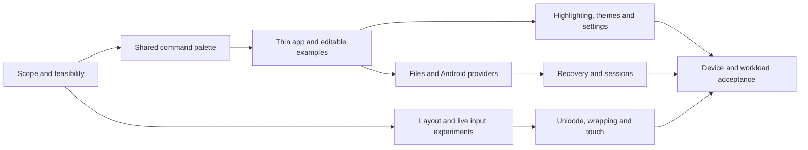

# Editor application — Delivery plan

The [contract](./SPEC.md) owns requirements. This page is the sole milestone
tracker; [testing](./testing.md) owns evidence and
[decisions](./decisions.md) owns unresolved design questions. A milestone is
complete only when its acceptance scenarios pass in the named configurations.

## Delivery dependencies

Arrows mean delivery prerequisites, not package imports. Shared library
changes must be validated in existing consumers before app integration is
accepted. Each implementation commit must build and pass its relevant tests.

## Milestones

| Slice                             | Obligations                                       | Deliverable and acceptance gate                                                                                                                                                                     | Status                                                                                                                                                                                          |
| --------------------------------- | ------------------------------------------------- | --------------------------------------------------------------------------------------------------------------------------------------------------------------------------------------------------- | ----------------------------------------------------------------------------------------------------------------------------------------------------------------------------------------------- |
| S0 — Contract and feasibility     | EAP1–EAP3, EAP9, EAP17, EAP20, EAP23–EAP24, EAP29 | Agreed ownership, palette test interfaces and risk experiments below; cold read, semantic review and publication validation recorded separately                                                     | partial: contract accepted; implementation feasibility gates remain open                                                                                                                        |
| P — Shared command palette        | EAP8–EAP11                                        | Display-independent state and catalog, shared widget view, invocation-target/context/identity/lifecycle scenarios, recording and TUI/Vulkan adapters; one public-behavior red→green slice at a time | partial: shared view/input and effective-shortcut tests pass; backend parity pending                                                                                                            |
| A — Thin editor shell             | EAP1–EAP7, EAP27–EAP28                            | Standard CLI/build identity, editable examples, tabs, command guide/palette and basic inspector; app recording-flow and native smoke evidence                                                       | partial: shell, tabs, examples, commands, clipboard, pointer, smoke, code presentation, undo inspector, indentation/comments and find/replace delivered; backend parity pending                 |
| H — Highlighting and presentation | EAP12–EAP16                                       | Shared per-line highlighted presentation with editor decorations, revision-safe background work, themes and generated settings; active-line and preview/cancel scenarios                            | partial: highlighting, theme and language pickers, generated settings and the document-font choice delivered; drawing the document in its own face pending                                      |
| U — Layout and input              | EAP17–EAP20                                       | Shared layout-backed navigation/hit-testing, Unicode corpus, terminal touch extraction and live IME on required native targets                                                                      | partial: bidi/wrap layout drives drawing, hits and motion; Unicode corpus replayed through the app; live GNOME preedit and caret rectangles verified; candidates, Android IME and touch pending |
| F — Real documents                | EAP21–EAP25                                       | UTF-8 fidelity, safe desktop saves, system document access on Android, conflict and dirty-close decisions; fault/provider tests and real-device evidence                                            | partial: native open/save/conflict and dirty-close tests pass; live close/provider acceptance pending                                                                                           |
| R — Session recovery              | EAP26                                             | Owner-accepted checkpoint/loss policy, versioned settings/session storage, dirty-buffer recovery and interruption/corruption tests; no implicit writes to originals                                 | partial: native checkpoint/restore, exit and versioned settings verified; lifecycle/resource limits and device latency pending                                                                  |
| V — Acceptance and measurements   | EAP2, EAP27–EAP30 and all earlier obligations     | Required target matrix, 1/10 MiB and long-line workloads, independent adversarial review, docs and per-commit build checks                                                                          | partial: document workloads measured; per-edit work on 10 MiB and 1 MiB lines, device runs and final review pending                                                                             |

## Next slice: document workflows

The palette's approved test interfaces remain in
[testing §2](./testing.md#2-command-palette-tdd). Its shared implementation is
available; complete backend/input parity remains an acceptance gate.

1. Open/Save/Save As now use the common command policy. Background saves
   capture revisions, compare destination bytes with the saved baseline and
   require informed replacement consent. Complete native dialog captures and
   failure/focus acceptance alongside dirty-close integration.
2. Save/Discard/Cancel now handles tab closure and deliberate exit, with a
   shared native close hook. Complete live close-button, in-flight failure
   and cross-focus clipboard acceptance; preserve per-document consent.
3. Add Android document-provider access/grants and the native IME experiments.
   Their actual guarantees remain separate from the native POSIX adapter.
4. Native recovery now includes durable revision display, continuous-edit
   scheduling, corruption/failure checks, explicit restore and orderly-exit
   decisions. Finish TUI/nonvetoable lifecycle, resource limits and actual
   one-second/device measurements under EAD11.

Generated font/settings controls, code-editor presentation
and conveniences, shared Unicode layout/touch input and workload acceptance
remain required. The native file work does not replace their delivery gates.

## Remaining implementation sequence

This sequence covers the remaining accepted scope, not just the current
checkpoint. Correctness failures found while validating an earlier slice take
precedence over the next feature. The milestone gates above remain authoritative;
a library preparation commit does not close an app or device acceptance gate.

1. **Shared layout and input geometry (U, S0).** `LayoutContext` now supplies
   one byte-keyed cell-grid result for drawing, visual caret movement, row
   edges, wrapped vertical motion and pointer hits in the app, and computes
   the IME caret area with affinity; the drawn caret area reaches the host
   (Wayland `set_cursor_rectangle`). Remaining: the Unicode corpus replay through the app, the
   real-font GPU comparison of rendered hits, and bounded long-paragraph work
   (each query lays out its whole paragraph; scrolling and the IME area lay
   out at most a viewport of lines; measure under V before claiming the
   1 MiB single-line workload). Shaped proportional flow stays with
   `sparkles:text-layout`.
2. **Generated settings and document fonts (H).** Delivered (testing §6,
   2026-11-16): font discovery, preparation and the fuzzy finder moved from
   text-lab into
   [`sparkles.ui_app.font_library`](../../libs/ui-app/reference/font-library.md),
   with real family members and the document font's controls from
   `sparkles.font.families`
   ([`FTD47`–`FTD51`](../font/discovery.md#_9-families-and-the-document-font));
   the app's generated pane over one `EditorSettings` subject, the family
   picker (monospace, with show-all), the bounded `DocumentFont` controls,
   their persistence and the visible report of unsupported controls.
   Remaining: drawing the document in that face — a widget subtree painted in
   the document face with its own cell metrics, applying line height, letter
   spacing and ligatures — per-style coordinates for a variable family's
   bold, and fontconfig on the package's library path. Document typography
   stays independent of interface typography.
3. **Editor presentation and tools (A, H).** Line numbers, current-line
   treatment, indentation guides, bracket matching and trailing-whitespace
   marks are drawn, each switchable (testing §6, 2026-11-16). Complete the undo-branch
   inspector, indentation/autoindent, language-aware commenting and the
   accepted editing actions through the common command policy.
4. **Find and replace (A, V).** Literal and regex search/replace, case and
   whole-word switches, match selection, protected spans and pattern/work
   limits are delivered (testing §6, 2026-11-16). Remaining: measure the
   bounded search on the 1/10 MiB workloads before claiming responsive
   large-document behavior.
5. **Live composition and touch (U).** Complete desktop and Android preedit,
   cancel/commit, focus and candidate placement with real input methods.
   Extract reusable terminal selection geometry/gestures, then implement
   editor handles, crossing, edge scrolling and selection actions. Verify
   Android keyboard insets and gesture ownership on actual devices.
6. **Android documents and remaining file workflows (F).** Build the editor
   APK/native entry, system document access/open-with, retained grants and
   provider save semantics. Test revocation, cancellation, failed writes,
   conflicts and informed weaker replacement. Finish native close/save
   requests that arrive during in-flight operations and remaining focus races.
7. **Session settings, lifecycle and resource bounds (R).** Persist the
   accepted settings alongside tabs/selections with explicit version handling.
   Bound archive discovery/retained restore state and complete nonvetoable
   lifecycle handling. Measure acknowledged one-second recovery on the
   supported devices; preserve failed/unconfirmed states and original files.
8. **Frontend parity and capability reporting (P, A, U).** Finish Lantern
   prefix timing/wakeups, palette/menu/touch integration and effective binding
   agreement. Exercise TUI and Vulkan on narrow/wide layouts and make actual
   unsupported host/input/font capabilities visible.
9. **Workload and device acceptance (V).** Run the 1 MiB, 10 MiB and 1 MiB
   single-line workloads, Unicode corpus and sustained edits/font changes.
   Profile before optimizing; report input, CPU/GPU frame, presentation and
   retained-memory measurements separately. A 120 Hz claim requires measured
   8.33 ms deadline behavior on a named device/refresh mode.
10. **Review and delivery (V).** Run the requested independent adversarial
    review with `agy` and Argon Medium, repair findings and rerun affected
    checks. Complete the Nix artifact, screenshots/diagnostics, documentation
    and per-commit build validation. Rebase/series cleanup follows repository
    policy and the owner's applicable authorization; pushing remains a
    separately authorized action.

The last independent review attempt was quota-blocked; final review is pending.
Desktop native clipboard,
storage and recovery evidence already recorded in testing.md does not replace
the remaining Wayland/Android, layout, IME or device-performance gates.

## Library extraction

The app keeps the wiring: `EditorApp`, the command catalog, the CLI, the
examples, the session record's schema and its scenario tests. Code that any
editing surface needs moves to the library that owns its concern, extending
what is already there rather than adding a second copy. Each step moves its
tests with it, keeps the app's scenario tests green, and updates the specs
and evidence citations that name the moved code. Branch
`refactor/editor-lift-libs`, stacked on `feat/editor-showcase`.

| Step | From (`apps/editor/src`)                                                                                             | To                                                                                                                                                                                               | Status    |
| ---- | -------------------------------------------------------------------------------------------------------------------- | ------------------------------------------------------------------------------------------------------------------------------------------------------------------------------------------------ | --------- |
| X1   | `document_text.d`: BOM, line-ending detection, Enter's ending                                                        | `sparkles.base.text.envelope`: `TextEnvelope`, `LineEnding`; `enterEnding` generic over any text with `lineOf`/`lineEnd`/`byteAt`                                                                | delivered |
| X2   | `document_files.d`: atomic create-only save, durability receipt, no-follow regular read                              | `sparkles.base.vfs.write` (VFO9 gains a create-only disposition and a directory-sync receipt) and the VFS's no-follow read                                                                       | delivered |
| X3   | `document_io.d`, `session_checkpoint.d`, `session_runtime.d`: ticketed `RawCpuPool` jobs                             | `sparkles.event_horizon.job_queue`: bounded submit, ticket, in-order completion, shutdown; `DocumentIo` stays in the app over it                                                                 | delivered |
| X4   | `rowPrefix`, `visualRowIndex`, `totalVisualRows` and `Document`'s cache fields                                       | `sparkles.ui.editor.layout`: a row index beside `LayoutContext`                                                                                                                                  | delivered |
| X5   | `statusPosition`'s cached grapheme column                                                                            | `sparkles.ui.editor.presentation`: the caret's line and column, cached per text and head                                                                                                         | delivered |
| X6   | `decimalDigits`, `lineLabel`, the numbering loop                                                                     | `sparkles.ui.components.gutter`: a line-number channel                                                                                                                                           | delivered |
| X7   | `session_directory`, `session_archive`, the generic half of `session_checkpoint`/`session_runtime`, `tools/*-fault*` | a new `sparkles:recovery`: leased private directories, numbered immutable generations, a coalescing background writer over opaque bytes; record, snapshot and discovery stay in the app          | delivered |
| X8   | `ClipboardRead`, `routeClipboard`, `receivePaste`, `clipboardOwnerValid`                                             | `sparkles.ui_app`: a clipboard router that joins paste chunks and delivers each reply only to the owner that asked                                                                               | delivered |
| X9   | `RowHit`, `DisplayedFrame`'s rows, `placeCaretAt`, `drawnCaretArea`                                                  | `sparkles.ui.components.editor`: hit testing and drag selection over the painted rows                                                                                                            | delivered |
| X10  | `find_bar.d` and the find bar's view                                                                                 | `sparkles.ui.editor.search` (state, `FindOption`) and a find-bar component                                                                                                                       | delivered |
| X11  | `undoRows`, `travelTo`                                                                                               | a history component over `sparkles.text_buffer.history`                                                                                                                                          | delivered |
| X12  | `documentMarks`, `findMarks`, trailing-whitespace marks; `PresentationSettings`, `EditingSettings`                   | `sparkles.ui.editor.presentation` (`TextMark`, `bracketMarks`, `trailingWhitespaceMarks`, `matchMarks`); `EditingSettings` stays, since `IndentOptions` is the library's form; toggle enums stay | delivered |
| X13  | `pointer()`: pixel-to-cell conversion, touch slop, the palette's touch panning                                       | `sparkles.ui_app` (pointer cells, slop) and `sparkles.ui.components.command_palette` (touch panning)                                                                                             | delivered |

X2 precedes X3 and X7 (the archive writes through the VFS). The rest are
independent. Modal dialogs and hit identities, the document font service and
the document/tab model need design first and are not on this list.

## Bounded feasibility experiments

Each experiment records its checked revision, command or procedure, result,
limit and decision in [testing's evidence ledger](./testing.md#6-evidence-ledger).
A negative result blocks only the named slice; it is not implementation
evidence for a promised capability.

| Question                                                      | Experiment                                                                                                                                                    | Decision criterion and blocked gate                                                                                                                                         |
| ------------------------------------------------------------- | ------------------------------------------------------------------------------------------------------------------------------------------------------------- | --------------------------------------------------------------------------------------------------------------------------------------------------------------------------- |
| Can one layout drive bidi movement, wrapping and hit-testing? | A short mixed-direction paragraph with paired punctuation, wrapped rows and ambiguous carets; compare independently worked positions and native rendered hits | Agree on byte/grapheme/visual positions and affinity without separate renderer-specific movement; blocks U                                                                  |
| Can highlighted spans retain editor decorations?              | Edit, select and compose inside one highlighted line, then deliver an older highlighting result                                                               | Syntax and decorations coexist; old work is rejected; blocks H                                                                                                              |
| Can native IME provide live composition?                      | Real desktop and Android CJK input: update/cancel/commit preedit, move focus, resize above keyboard and reposition candidates                                 | Observe the preedit and one committed revision, with usable candidate/caret placement; conversion replay alone fails the gate; blocks U                                     |
| What guarantees can storage adapters offer?                   | Desktop replacement plus a real Android provider: permission revocation, failed write, external modification and cancellation                                 | State the commit point and conflict/atomicity guarantees per adapter; preserve dirty contents through failure; blocks F and R                                               |
| What bounds keep long work cancellable?                       | 1/10 MiB files, one 1 MiB line, adversarial search pattern and sustained edits while highlighting queues fill                                                 | Select explicit work/queue limits and cancellation service bounds without truncation or frame-thread whole-document work; blocks V and applicable search/highlight delivery |

## Resume checkpoint

- Contract: owner-confirmed Q1–Q22, written on branch `feat/editor-showcase`.
- Implementation base: `755e1b9101` on `origin/main`, after PR 715;
  editor specification commit `b5ea7fddd`. The worktree remains separate from
  the font-rendering worktree.
- Completed scope: shared palette core/view/input/shortcut discovery; the
  Vulkan/TUI editor shell, independent tabs, editable examples, syntax/editor
  decoration overlay, background highlighting and theme preview; exact
  in-memory document envelopes and per-selection Enter conventions. Native
  file primitives, syscall-fault checks and CLI-open integration are at the
  current validation checkpoint. Native Save/Save As and overwrite decisions
  pass app tests, as do dirty-close decisions and the shared native close
  hook. Native background recovery, retention, startup restore/adoption and
  exit flush pass tests and a live X11 process-interruption round trip.
  Background language discovery and per-tab manual overrides pass app/library
  tests. The cell-grid bidi/wrap layout context drives document drawing,
  hits and motion. Generated settings/fonts, complete recovery acceptance
  and the Unicode corpus, real-font hits, touch and IME remain open.
- Evidence and reviews: [testing §6](./testing.md#6-evidence-ledger).
- Next executable action (2026-11-16): drawing the document in its chosen
  face (a widget subtree with its own cell metrics), incremental row counts
  and windowed span production for 10 MiB files and 1 MiB lines, then the
  device gates: Android live IME, keyboard insets, providers and lifecycle on
  the tablet, candidates with a candidate-producing input method, and touch
  selection. Presentation, the undo inspector, indentation and comments,
  find/replace, generated and persisted settings, the font choice, the
  Unicode corpus replay and the workload measurements are delivered (testing
  §6, 2026-11-16).
- Owner policies: visual bidi movement/collapse, convention-aware Enter and
  one-second recovery checkpoints are accepted in EAD9–EAD11. Layout,
  storage and scheduling implementations still require their acceptance tests.
