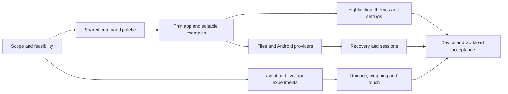

# Editor application — Delivery plan

The [contract](./SPEC.md) owns requirements. This page is the sole milestone
tracker; [testing](./testing.md) owns evidence and
[decisions](./decisions.md) owns unresolved design questions. A milestone is
complete only when its acceptance scenarios pass in the named configurations.

## Delivery dependencies

Arrows mean delivery prerequisites, not package imports. Shared library
changes must be validated in existing consumers before app integration is
accepted. Each implementation commit must build and pass its relevant tests.

## Milestones

| Slice                             | Obligations                                       | Deliverable and acceptance gate                                                                                                                                                                     | Status                                                                                                                                          |
| --------------------------------- | ------------------------------------------------- | --------------------------------------------------------------------------------------------------------------------------------------------------------------------------------------------------- | ----------------------------------------------------------------------------------------------------------------------------------------------- |
| S0 — Contract and feasibility     | EAP1–EAP3, EAP9, EAP17, EAP20, EAP23–EAP24, EAP29 | Agreed ownership, palette test interfaces and risk experiments below; cold read, semantic review and publication validation recorded separately                                                     | partial: contract accepted; implementation feasibility gates remain open                                                                        |
| P — Shared command palette        | EAP8–EAP11                                        | Display-independent state and catalog, shared widget view, invocation-target/context/identity/lifecycle scenarios, recording and TUI/Vulkan adapters; one public-behavior red→green slice at a time | partial: shared view/input and effective-shortcut tests pass; backend parity pending                                                            |
| A — Thin editor shell             | EAP1–EAP7, EAP27–EAP28                            | Standard CLI/build identity, editable examples, tabs, command guide/palette and basic inspector; app recording-flow and native smoke evidence                                                       | partial: shell, tabs, commands, clipboard, pointer and native/TUI smoke; examples and full tools pending                                        |
| H — Highlighting and presentation | EAP12–EAP16                                       | Shared per-line highlighted presentation with editor decorations, revision-safe background work, themes and generated settings; active-line and preview/cancel scenarios                            | partial: shared syntax/editor overlay and background revisions verified; examples/themes under validation, settings and language picker pending |
| U — Layout and input              | EAP17–EAP20                                       | Shared layout-backed navigation/hit-testing, Unicode corpus, terminal touch extraction and live IME on required native targets                                                                      | not started                                                                                                                                     |
| F — Real documents                | EAP21–EAP25                                       | UTF-8 fidelity, safe desktop saves, system document access on Android, conflict and dirty-close decisions; fault/provider tests and real-device evidence                                            | not started                                                                                                                                     |
| R — Session recovery              | EAP26                                             | Owner-accepted checkpoint/loss policy, versioned settings/session storage, dirty-buffer recovery and interruption/corruption tests; no implicit writes to originals                                 | not started                                                                                                                                     |
| V — Acceptance and measurements   | EAP2, EAP27–EAP30 and all earlier obligations     | Required target matrix, 1/10 MiB and long-line workloads, independent adversarial review, docs and per-commit build checks                                                                          | not started                                                                                                                                     |

## Next slice: command palette

The approved test interfaces are state transitions, command discovery and
shared view integration ([testing §2](./testing.md#2-command-palette-tdd)).
Proposed names and storage layouts are not approved APIs.

1. Define the command descriptor and identity relationship to existing
   `Binding!(Cmd, Scope)` data. Distinguish operation plus arguments from a
   shortcut; support commands without shortcuts. Record ownership, bounded
   query/results storage and exhaustion outcomes before implementing them.
2. Write a failing public-behavior test for opening and cancelling a palette:
   no command effect, unchanged document and restored focus. Implement that
   behavior, then proceed to query, navigation and acceptance as separate
   cycles.
3. Add manually enumerated context/argument cases, including a command
   invalidated between search and acceptance. Establish exactly-once command
   emission and stale-result rejection before asynchronous adapters.
4. Produce the shared view and replay the same behavior through recording,
   TUI and Vulkan adapters. Reuse fuzzy matching and picker mechanisms rather
   than duplicating their algorithms.

Success is a backend-independent palette usable by the editor and another
consumer. Wiring Hue wholesale is not a prerequisite; the shared interfaces
must permit its command policy without importing Hue types.

## Bounded feasibility experiments

Each experiment records its checked revision, command or procedure, result,
limit and decision in [testing's evidence ledger](./testing.md#6-evidence-ledger).
A negative result blocks only the named slice; it is not implementation
evidence for a promised capability.

| Question                                                      | Experiment                                                                                                                                                    | Decision criterion and blocked gate                                                                                                                                         |
| ------------------------------------------------------------- | ------------------------------------------------------------------------------------------------------------------------------------------------------------- | --------------------------------------------------------------------------------------------------------------------------------------------------------------------------- |
| Can one layout drive bidi movement, wrapping and hit-testing? | A short mixed-direction paragraph with paired punctuation, wrapped rows and ambiguous carets; compare independently worked positions and native rendered hits | Agree on byte/grapheme/visual positions and affinity without separate renderer-specific movement; blocks U                                                                  |
| Can highlighted spans retain editor decorations?              | Edit, select and compose inside one highlighted line, then deliver an older highlighting result                                                               | Syntax and decorations coexist; old work is rejected; blocks H                                                                                                              |
| Can native IME provide live composition?                      | Real desktop and Android CJK input: update/cancel/commit preedit, move focus, resize above keyboard and reposition candidates                                 | Observe the preedit and one committed revision, with usable candidate/caret placement; conversion replay alone fails the gate; blocks U                                     |
| What guarantees can storage adapters offer?                   | Desktop replacement plus a real Android provider: permission revocation, failed write, external modification and cancellation                                 | State the commit point and conflict/atomicity guarantees per adapter; preserve dirty contents through failure; blocks F and R                                               |
| What bounds keep long work cancellable?                       | 1/10 MiB files, one 1 MiB line, adversarial search pattern and sustained edits while highlighting queues fill                                                 | Select explicit work/queue limits and cancellation service bounds without truncation or frame-thread whole-document work; blocks V and applicable search/highlight delivery |

## Resume checkpoint

- Contract: owner-confirmed Q1–Q22, written on branch `feat/editor-showcase`.
- Implementation base: `755e1b9101` on `origin/main`, after PR 715;
  editor specification commit `b5ea7fddd`. The worktree remains separate from
  the font-rendering worktree.
- Completed scope: shared palette core lifecycle, bounded catalog, fuzzy
  discovery/witnesses, navigation, invocation revalidation, stamped row actions,
  query input, widget view and effective-shortcut discovery. The initial
  `apps/editor` shell is under validation. Touch extraction, native IME and
  full application conformance remain open.
- Evidence and reviews: [testing §6](./testing.md#6-evidence-ledger).
- Next executable action: finish the reviewed frontend checkpoint, validate
  the editor shell in recording/TUI/Vulkan, then integrate document storage,
  highlighted editing and generated settings through their shared mechanisms.
- Owner policies: visual bidi movement/collapse, convention-aware Enter and
  one-second recovery checkpoints are accepted in EAD9–EAD11. Layout,
  storage and scheduling implementations still require their acceptance tests.
