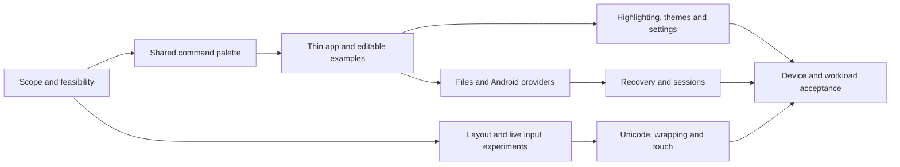

# Editor application — Delivery plan

The [contract](./SPEC.md) owns requirements. This page is the sole milestone
tracker; [testing](./testing.md) owns evidence and
[decisions](./decisions.md) owns unresolved design questions. A milestone is
complete only when its acceptance scenarios pass in the named configurations.

## Delivery dependencies

Arrows mean delivery prerequisites, not package imports. Shared library
changes must be validated in existing consumers before app integration is
accepted. Each implementation commit must build and pass its relevant tests.

## Milestones

| Slice                             | Obligations                                       | Deliverable and acceptance gate                                                                                                                                                                     | Status                                                                                                                            |
| --------------------------------- | ------------------------------------------------- | --------------------------------------------------------------------------------------------------------------------------------------------------------------------------------------------------- | --------------------------------------------------------------------------------------------------------------------------------- |
| S0 — Contract and feasibility     | EAP1–EAP3, EAP9, EAP17, EAP20, EAP23–EAP24, EAP29 | Agreed ownership, palette test interfaces and risk experiments below; cold read, semantic review and publication validation recorded separately                                                     | partial: contract accepted; implementation feasibility gates remain open                                                          |
| P — Shared command palette        | EAP8–EAP11                                        | Display-independent state and catalog, shared widget view, invocation-target/context/identity/lifecycle scenarios, recording and TUI/Vulkan adapters; one public-behavior red→green slice at a time | partial: shared view/input and effective-shortcut tests pass; backend parity pending                                              |
| A — Thin editor shell             | EAP1–EAP7, EAP27–EAP28                            | Standard CLI/build identity, editable examples, tabs, command guide/palette and basic inspector; app recording-flow and native smoke evidence                                                       | partial: shell, tabs, editable examples, commands, clipboard, pointer and native/TUI smoke; full tools pending                    |
| H — Highlighting and presentation | EAP12–EAP16                                       | Shared per-line highlighted presentation with editor decorations, revision-safe background work, themes and generated settings; active-line and preview/cancel scenarios                            | partial: shared syntax/editor overlay, background revisions and theme preview verified; font/settings and language picker pending |
| U — Layout and input              | EAP17–EAP20                                       | Shared layout-backed navigation/hit-testing, Unicode corpus, terminal touch extraction and live IME on required native targets                                                                      | not started                                                                                                                       |
| F — Real documents                | EAP21–EAP25                                       | UTF-8 fidelity, safe desktop saves, system document access on Android, conflict and dirty-close decisions; fault/provider tests and real-device evidence                                            | partial: native open/save/conflict and dirty-close tests pass; live close/provider acceptance pending                             |
| R — Session recovery              | EAP26                                             | Owner-accepted checkpoint/loss policy, versioned settings/session storage, dirty-buffer recovery and interruption/corruption tests; no implicit writes to originals                                 | not started                                                                                                                       |
| V — Acceptance and measurements   | EAP2, EAP27–EAP30 and all earlier obligations     | Required target matrix, 1/10 MiB and long-line workloads, independent adversarial review, docs and per-commit build checks                                                                          | not started                                                                                                                       |

## Next slice: document workflows

The palette's approved test interfaces remain in
[testing §2](./testing.md#2-command-palette-tdd). Its shared implementation is
available; complete backend/input parity remains an acceptance gate.

1. Open/Save/Save As now use the common command policy. Background saves
   capture revisions, compare destination bytes with the saved baseline and
   require informed replacement consent. Complete native dialog captures and
   failure/focus acceptance alongside dirty-close integration.
2. Save/Discard/Cancel now handles tab closure and deliberate exit, with a
   shared native close hook. Complete live close-button, in-flight failure
   and cross-focus clipboard acceptance; preserve per-document consent.
3. Add Android document-provider access/grants and the native IME experiments.
   Their actual guarantees remain separate from the native POSIX adapter.
4. Implement recovery/session checkpoints under EAD11, including durable
   revision display, continuous-edit scheduling, corruption and storage-failure
   scenarios, and orderly-exit flush/decision handling.

Generated font/settings controls, language discovery, code-editor presentation
and conveniences, shared Unicode layout/touch input and workload acceptance
remain required. The native file work does not replace their delivery gates.

## Bounded feasibility experiments

Each experiment records its checked revision, command or procedure, result,
limit and decision in [testing's evidence ledger](./testing.md#6-evidence-ledger).
A negative result blocks only the named slice; it is not implementation
evidence for a promised capability.

| Question                                                      | Experiment                                                                                                                                                    | Decision criterion and blocked gate                                                                                                                                         |
| ------------------------------------------------------------- | ------------------------------------------------------------------------------------------------------------------------------------------------------------- | --------------------------------------------------------------------------------------------------------------------------------------------------------------------------- |
| Can one layout drive bidi movement, wrapping and hit-testing? | A short mixed-direction paragraph with paired punctuation, wrapped rows and ambiguous carets; compare independently worked positions and native rendered hits | Agree on byte/grapheme/visual positions and affinity without separate renderer-specific movement; blocks U                                                                  |
| Can highlighted spans retain editor decorations?              | Edit, select and compose inside one highlighted line, then deliver an older highlighting result                                                               | Syntax and decorations coexist; old work is rejected; blocks H                                                                                                              |
| Can native IME provide live composition?                      | Real desktop and Android CJK input: update/cancel/commit preedit, move focus, resize above keyboard and reposition candidates                                 | Observe the preedit and one committed revision, with usable candidate/caret placement; conversion replay alone fails the gate; blocks U                                     |
| What guarantees can storage adapters offer?                   | Desktop replacement plus a real Android provider: permission revocation, failed write, external modification and cancellation                                 | State the commit point and conflict/atomicity guarantees per adapter; preserve dirty contents through failure; blocks F and R                                               |
| What bounds keep long work cancellable?                       | 1/10 MiB files, one 1 MiB line, adversarial search pattern and sustained edits while highlighting queues fill                                                 | Select explicit work/queue limits and cancellation service bounds without truncation or frame-thread whole-document work; blocks V and applicable search/highlight delivery |

## Resume checkpoint

- Contract: owner-confirmed Q1–Q22, written on branch `feat/editor-showcase`.
- Implementation base: `755e1b9101` on `origin/main`, after PR 715;
  editor specification commit `b5ea7fddd`. The worktree remains separate from
  the font-rendering worktree.
- Completed scope: shared palette core/view/input/shortcut discovery; the
  Vulkan/TUI editor shell, independent tabs, editable examples, syntax/editor
  decoration overlay, background highlighting and theme preview; exact
  in-memory document envelopes and per-selection Enter conventions. Native
  file primitives, syscall-fault checks and CLI-open integration are at the
  current validation checkpoint. Native Save/Save As and overwrite decisions
  pass app tests, as do dirty-close decisions and the shared native close
  hook. Generated settings/fonts,
  language discovery, recovery and Unicode layout/touch/IME remain open.
- Evidence and reviews: [testing §6](./testing.md#6-evidence-ledger).
- Next executable action: validate the native close checkpoint, then deliver
  recovery/session checkpoints and the remaining settings, Unicode, provider
  and workload gates. Clipboard request identity across focus changes remains
  an explicit input acceptance scenario.
- Owner policies: visual bidi movement/collapse, convention-aware Enter and
  one-second recovery checkpoints are accepted in EAD9–EAD11. Layout,
  storage and scheduling implementations still require their acceptance tests.
