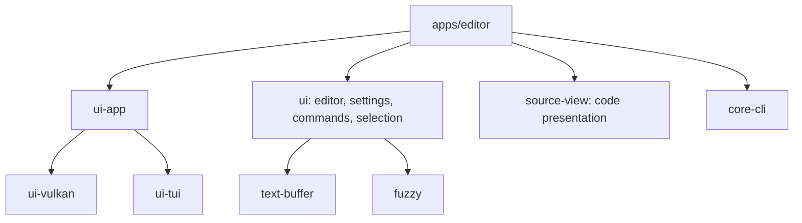

# Editor application — Specification

## Abstract

`sparkles:editor` is a practical code editor and an interactive showcase of
Sparkles' shared editing libraries. It opens real documents, highlights code,
supports several cursors and branching undo, and exposes the same commands
through shortcuts, a searchable palette and a
[key guide](../../glossary.md#key-guide). Vulkan windows on
desktop and Android are its production surface; a terminal interface exercises
the same editing behavior. The application combines reusable editing, layout,
highlighting and input components, with optional diagnostics that make Unicode
behavior and responsiveness observable without intruding on ordinary editing.

## Introduction

A text field proves that a library can accept input. A usable editor asks more:
selection must follow what is drawn, wrapped lines must remain navigable, a
phone's keyboard must leave the caret visible, and saving must not lose work.
Code documents add syntax highlighting, long lines and large files. Mixed
scripts add shaping and bidirectional layout, where byte order and visual
position differ.

The `sparkles:ui` [shared editor](../ui/editor.md) owns editing semantics and its
[text buffer](../text-buffer/SPEC.md) owns persistent document contents and
history. The application makes those capabilities usable together with code
highlighting, font controls, real file access and sessions that recover unsaved
text and restore tab, cursor and scroll positions. It is
also a place to expose integration defects that isolated text fields cannot
demonstrate.

The central design is a thin application over shared mechanisms. One layout
model supplies drawing, caret movement and hit-testing. One command catalog
supplies execution and discovery. Background work observes document revisions
and cannot overwrite newer edits. Application policy chooses documents,
commands and settings; reusable editing behavior remains in libraries.

This contract covers multiple open tabs in one active document pane, with no
split views, on desktop Vulkan, Android and a terminal interface. Terminal
rendering and composition follow declared host capabilities while document
editing effects stay shared. It does not cover project navigation,
language servers, plugins, collaborative editing, arbitrary file encodings or
binary editing. Raylib is an optional way to test library boundaries, not a
production dependency. Whole-application Hue restructuring is outside scope;
the editor extracts only shared capabilities it actually uses.

[Sections 1–8](#1-ownership-and-supported-surfaces) state the application
requirements and integration boundaries. [PLAN.md](./PLAN.md) owns delivery
order and progress. [testing.md](./testing.md) defines falsifying scenarios,
oracles and evidence. [decisions.md](./decisions.md) records accepted choices
and feasibility questions. The shared editor's normative editing algorithms
remain in [the UI editor specification](../ui/editor.md).

## Contract at a glance

1. Desktop Vulkan, Android and TUI use the same editing and command semantics;
   unavailable host capabilities are reported explicitly.
2. The application owns document/session policy. Shared libraries own editing,
   layout, command discovery, highlighting and reusable touch interaction.
3. Rendering, movement, selection, hit-testing and input-method positioning
   agree on document revision and layout geometry.
4. Editing never silently overwrites external changes, discards dirty text or
   accepts stale background results.
5. The command palette and [key guide](../../glossary.md#key-guide) are two
   frontends over the same command policy. Their state is testable without a
   display.
6. A passing model test does not establish live composition, provider save
   guarantees, rendered Unicode correctness or a frame-rate claim.

## 1. Ownership and supported surfaces

Normative keywords **must**, **must not** and **may** express obligations,
prohibitions and permitted behavior. Requirement IDs beginning with `EAP`
belong to this application contract; the linked UI requirements retain their
existing owners. Proposed module names are not shipped APIs.

**EAP1: Thin application.** `apps/editor` **must** own application commands,
document/session policy and composition of shared components. Editing
algorithms, highlighting presentation shared with Hue, the command palette and
reusable touch-selection behavior **must** live in reusable libraries without
dependencies on either application's modules.

The package dependency direction is from the application to its libraries:

This graph assigns integration ownership, not a declaration of new package
dependencies. Shared modules may be extracted into existing packages; a
package per feature is not required. Windowing, input-method events and
document-provider operations belong to host/platform adapters. Font parsing
and rendering remain owned by the font and canvas libraries.

**EAP2: Required targets.** The app **must** support desktop Vulkan, Android
Vulkan and TUI with editable documents, tabs, command discovery, clipboard
integration where offered, settings and save/recovery behavior. Android
**must** be usable without a hardware keyboard. Visual features unavailable
in a terminal **must** be described as capability limitations rather than
silently disabling editing.

**EAP3: CLI and identity.** Startup **must** use `core-cli`'s `runCli`, its
`LogLevel logLevel` convention, stamped version/build information and the
common window/font/backend options from `ui-app`. File operands and
application options **must** be validated before their effects begin; invalid
options **must** produce CLI errors rather than assertion traces. Vulkan
**must** be the production window path.

## 2. Document surface and editing

**EAP4: Documents and tabs.** Startup **must** permit an editable example, a
new untitled document or a local UTF-8 file. Tabs **must** retain independent
text, selections, undo histories, scroll positions and dirty state; switching
tabs **must not** reset them. One document pane is active at a time.

**EAP5: Code-editor presentation.** The active document **must** offer line
numbers, current-line highlighting, indentation guides, bracket matching,
search/replace and a status bar. Settings **must** control their visibility
where applicable. A narrow layout **must** keep text, caret and commands
reachable without requiring a desktop sidebar.

**EAP6: Shared editing capabilities.** The app **must** expose the shared
editor's grapheme-aware editing, normalized multiple selections, occurrence
selection, vertical cursor addition, rectangular selection, protected spans,
kill/yank and branching undo through discoverable commands. An undo-history
inspector and a protected-text example **must** make those two capabilities
directly demonstrable. Their semantics are owned by
[UI editor §§2–6](../ui/editor.md), not redefined here.

**EAP7: Editing conveniences.** The app **must** provide configurable tabs
versus spaces and indentation width, conservative auto-indent, and line
commenting where language metadata supports it. Search/replace **must** offer
literal and regular-expression modes, case sensitivity and whole-word
matching; invalid patterns **must** report an error without changing text.
Replacements **must** be undoable through the shared editor.

Automatic bracket/quote insertion, structural folding, completion and formatter
integration are deferred. General text editing remains available when a
language has no comment syntax or highlighting provider.

## 3. Commands, palette and key guide

**EAP8: Shared command policy.** Commands **must** have stable identities,
arguments, labels and context-dependent availability. Keyboard dispatch,
Lantern, the fuzzy command palette, menus and touch controls **must** refer to
that policy rather than independently maintained command lists. Commands with
the same operation and different arguments **must not** be collapsed into one
entry. An unbound command **must** remain discoverable through the palette.

Binding normalization, precedence, configuration overlays and key-guide
behavior are owned by [UI keymap and Lantern](../ui/keymap.md); app policy
also follows the [design-system keyboard rules](../design-system/keyboard.md).
[Hue's guide](../hue/lantern.md) and the
[terminal's keymap](../terminal/keymap.md) are integration references, not
dependencies on their application command enums.

**EAP9: Palette state and portability.** The command palette **must** be a
`libs/ui` component whose state transitions, discovery and effects can be
tested without a renderer, window, terminal or implicit clock. Its behavior
**must** be developed in vertical TDD slices through the three public test
interfaces in [testing.md](./testing.md#2-command-palette-tdd).

**EAP10: Palette lifecycle.** Opening the palette **must** capture its return
focus, query and applicable command context. Query edits **must** produce a
deterministically ranked list with fuzzy-match highlighting and active
shortcut labels. Empty results **must** be navigable as an empty state;
acceptance with no selected result **must not** execute a command. Acceptance
of an available result **must** close the palette and emit exactly one command
identity with its arguments. Cancellation **must** emit no command, preserve
document state and restore the previous focus.

If commands or context change while the palette is open, selection is retained
by command identity when possible, otherwise moved to an available result.
Acceptance rechecks availability; a command invalidated since ranking cannot
execute. Duplicate or stale accept/search events cannot execute twice or
replace newer results. Result text and query storage must remain valid until
the consumer releases the corresponding state/view.

The invocation target is the document or app surface from which the palette
opened, distinct from the focused query field. Query focus does not redirect
document commands into the query or hide their catalog. Discovery and
acceptance evaluate the live availability of that invocation target. Closing
the target invalidates its document commands; switching the active tab does
not silently retarget them. On closure, focus returns to the invocation target
if it still exists, otherwise the active valid app surface. App/global commands
retain their own explicit target policy.

**EAP11: Shortcut and touch access.** Platform shortcuts and the shared
Readline layer **must** coexist using the shared editor's target policy.
Application key overlays **must** be configurable. Lantern **must** use an
explicit modified [leader](../../glossary.md#leader) chord: typing a space in
a document **must** insert a space. A visible touch opener **must** expose the
same guide, including tappable groups and command rows, without a keyboard.

## 4. Highlighting, themes and font settings

**EAP12: Shared highlighting.** Syntax highlighting **must** use
`sparkles:source-view` presentation and shared syntax facilities, detecting
language from the file name and permitting a fuzzy manual override. Carets,
selections, protected spans and composition **must** compose with syntax
styles; an active line **must not** lose highlighting simply because it is
edited. App-specific copies of Hue's rendering or parsing loops are forbidden
by EAP1.

**EAP13: Revision-aware work.** Highlighting and other background document
work **must** consume a retained revision or snapshot, leave typing available
while pending, and publish only results matching the document identity,
revision and relevant configuration. Cancellation or tab closure **must not**
release borrowed storage before the worker completes. Failures **must** leave
text editable and permit an explicit plain-text presentation.

**EAP14: Theme preview.** A fuzzy theme picker **must** apply the selected
preview to document syntax and app chrome together. Cancellation **must**
restore the accepted theme; acceptance **must** persist the choice. Preview
**must not** modify text, undo history or dirty state. Theme data and reusable
picker behavior **must** be shared with other consumers.

**EAP15: Generated settings.** The settings pane **must** be generated from
one settings subject through `PropertyTree!T`, using shared numeric editors
and declared runtime bounds. It **must** include the agreed code-editor
font controls, theme and presentation settings without a parallel manually
rendered settings model.

**EAP16: Code-font controls.** Font selection **must** default to a
monospace-filtered fuzzy list with an explicit show-all option. The app
**must** offer size, real regular/bold/italic family members, ligatures,
line height and letter spacing; weight and optical size controls **must**
appear only when the face declares the axes. UI typography **must** remain
independent of document typography. Unsupported font/style capabilities
**must** be visible; arbitrary axis exploration belongs to text-lab.

## 5. Unicode layout, touch and composition

**EAP17: One layout authority.** For a document revision and viewport,
drawing, hit-testing, caret placement, selection geometry, wrapped movement
and input-method placement **must** use the same layout result or an
equivalent result with explicit revision identity. A stale layout **must not**
direct an edit into a different revision's byte offsets.

**EAP18: Unicode editing.** The curated corpus **must** support visible
fallback glyphs, shaping and whole-grapheme editing for mixed scripts,
combining marks, complex-script syllables and emoji sequences. Left/Right
**must** follow visual caret positions in bidirectional text; word/document
commands **must** retain their documented logical semantics. Wrapped Up/Down,
Home/End and drag selection **must** agree with visible rows. Bidi-boundary
caret affinity **must** be explicit in the shared layout interface and
observable in diagnostics.

Without Shift, Left/Right **must** collapse a nonempty selection to its visual
left/right edge. Shift **must** extend from a fixed logical anchor along visual
caret stops. Home/End **must** mean the visual left/right edge of the wrapped
row, including RTL rows. The shared editor's layout-aware motion contract owns
these semantics; logical-only contexts retain their documented fallback.

Unicode segmentation and ordering follow the owning
[base text contract](../base/text/SPEC.md); editing effects follow
[the UI editor contract](../ui/editor.md). The application conformance corpus
and deliberately unsupported behaviors are specified in
[testing §3](./testing.md#3-unicode-and-input-oracles).

**EAP19: Touch selection.** Long-press selection, endpoint handles,
finger-offset-preserving drags, crossing endpoints, edge scrolling and
selection actions **must** be available on Android. Gesture ownership **must**
distinguish handle/menu capture from ordinary document scrolling, and menus
**must not** obscure the selection or keyboard-adjusted editing region.
Reusable geometry, placement and gesture behavior **must** be extracted from
the terminal's selection implementation where applicable, with editor and
terminal adapters retaining their respective document models and actions.

**EAP20: Live input methods.** Desktop Vulkan and Android **must** integrate
live preedit, commit, cancellation and candidate/caret positioning with the
shared composition model. Focus, keyboard visibility and viewport insets
**must** preserve usable text and selection. A keyboard dismissed by the user
**must not** reopen on every idle frame. Composition replay tests alone
**must not** satisfy this requirement; real input methods are required.
TUI composition limits follow host capability reporting under EAP2.

## 6. Files, saving and recovery

**EAP21: UTF-8 fidelity.** Opening and saving **must** preserve UTF-8 BOM
presence and line-ending conventions, including mixed endings unless the
user explicitly converts them. Invalid UTF-8 and unsupported/binary input
**must** be refused with an actionable message without replacing an already
open document. Non-regular desktop inputs **must not** be opened through a
blocking file-read path. No implicit normalization or encoding conversion is
permitted.

Enter **must** follow the current logical line's ending, falling back to the
document's predominant ending and then LF when no ending is established.
Pasted and replacement text **must** preserve its supplied line endings.
Untouched mixed endings **must** remain unchanged. The app expresses
convention-aware Enter as inserted text; the shared editor's generic
`insertNewline` operation retains its LF semantics.

**EAP22: Save commit point.** Save and Save As **must** retain dirty state
and recoverable contents until the storage adapter confirms success for the
saved revision. Edits made during a save **must** remain dirty after that
older revision succeeds. A failed save **must** preserve the buffer, report
the failure and permit retry or another destination. Repeating an operation
after cancellation or a stale completion **must not** silently write another
document or report a newer revision as saved.

**EAP23: External changes.** Before replacing existing file contents, saving
**must** detect an externally changed document and require a conflict decision
rather than silently overwriting it. Desktop storage **must** use atomic
replacement where available. A provider that cannot guarantee atomicity or
conditional replacement **must** disclose that limitation before replacement;
it **must not** claim the stronger guarantee. Refusal/cancellation preserves
dirty text and recovery data.

Where the adapter cannot exclude a change between validation and replacement,
the app **must** explain the race and obtain explicit informed overwrite
authorization for that operation, or offer another destination. It **must not**
perform the weaker replacement silently. Authorization does not turn a
nonconditional write into a conditional one; diagnostics retain the actual
guarantee.

**EAP24: Android document access.** Android **must** support system document
open/create/save and incoming open-with intents, including documents supplied
by other applications. Examples **must** work without broad filesystem
permission. Revoked grants, unavailable providers and cancelled pickers
**must** leave the active document intact and offer a useful failure or
cancellation outcome. URI/provider identities **must not** be treated as
ordinary filesystem paths.

**EAP25: Dirty-document closure.** Closing a dirty tab or deliberately exiting
with dirty documents **must** offer Save, Discard and Cancel. Cancel
**must** retain the document and focus; a failed save **must not** proceed as
if saved. Explicit Discard authorizes discarding that document's changes,
not unrelated tabs.

**EAP26: Persistence and recovery.** Accepted settings, tabs, cursor/scroll
positions and unsaved document contents **must** survive restart through
versioned session/recovery storage. Unexpected interruption **must** offer
recoverable dirty contents without silently writing the original files.
Corrupt, unsupported or partially written recovery records **must** be
reported and preserved for recovery rather than destroying openable records.
Recovery errors **must not** prevent a fresh empty document from opening.

Recovery **must** identify the latest durably recoverable revision separately
from the latest in-memory revision, and **must not** acknowledge a newer
revision as recoverable before its checkpoint commits. Orderly exit **must**
flush authorized retained recovery state or surface failure before claiming
it was preserved. Unexpected interruption guarantees the last committed
checkpoint under the storage adapter's stated durability assumptions.
Dirty buffers **must** be checkpointed within one second after edits; continuous
typing **must not** postpone every checkpoint indefinitely. Checkpoint failure
**must** surface a persistent recovery warning while allowing continued editing.
The durable revision remains the last acknowledged checkpoint, so a failed
checkpoint explicitly suspends the one-second recovery guarantee until storage
recovers. Orderly exit **must** flush or ask how to proceed on failure.

## 7. Diagnostics, workloads and evidence

**EAP27: Optional inspection.** An optional inspector **must** expose logical
selection/caret offsets and affinity, composition state, undo branches,
document size, highlighting work and frame timings. Diagnostics **must**
distinguish unsupported, pending, failed and completed work. Ordinary editing
**must not** require understanding implementation details. Diagnostic exports
**must not** include document contents, file paths or composition text by
default; richer inspection/export requires an explicit user action.

**EAP28: Reproducible captures.** The app **must** support deterministic
example documents and screenshot capture using shared host facilities.
Captures **must** identify the selected sample, theme, language and relevant
settings; pending startup work **must** either reach its defined readiness
condition or fail explicitly rather than silently capturing an empty editor.
Screenshots establish pixels for their captured configuration, not editing
correctness or input latency.

**EAP29: Large-document progress.** Typing, selection, scrolling and undo
**must** remain available for 1 MiB and 10 MiB UTF-8 documents and a single
1 MiB line. Viewport rendering and background highlighting **must not**
silently truncate documents or require rendering the entire file for an idle
frame. Long-running open/search/highlight operations **must** expose pending
state and cancellation at bounded continuation points. Resource exhaustion
**must** report failure while preserving existing dirty documents.

**EAP30: Performance claims.** Reports **must** include cold-open time,
input latency, CPU/GPU frame-time distributions, memory and relevant device,
toolchain, build mode and workload settings. A 120 Hz target corresponds to
an 8.33 ms frame budget on hardware that offers that refresh rate. It is a
target to measure, not a universal delivery guarantee. Averages, submission
timestamps and replayed inputs **must not** be presented as proof of observed
input-to-display latency or sustained 120 Hz. Missed targets remain visible.

Concrete queue/storage limits, cancellation service bounds, regular-expression
work limits and performance thresholds require the bounded feasibility work
in [PLAN.md](./PLAN.md) before their respective implementation gates close.
No unspecified limit permits silently dropping text, commands or results.

## 8. Scope exclusions and acceptance authority

The scope excludes split document panes, project/workspace navigation, LSP,
plugins, completion, formatter integrations, automatic pairing, structural
folding, collaborative editing and non-UTF-8/binary editing. Adding these
requires a contract revision, not incidental implementation convenience.
Platform-specific document pickers and live input methods remain mandatory
integration work rather than exceptions to the thin-app goal.

The owner accepted this scope through requirements rounds Q1–Q22 on
2026-11-05. [decisions.md](./decisions.md) records the resulting boundaries.
Implementation acceptance requires the scenarios and honest evidence in
[testing.md](./testing.md), independent review of high-risk shared changes,
and explicit disposition of unresolved blockers. Acceptance of this contract
does not assert that the application or shared extensions are implemented.
